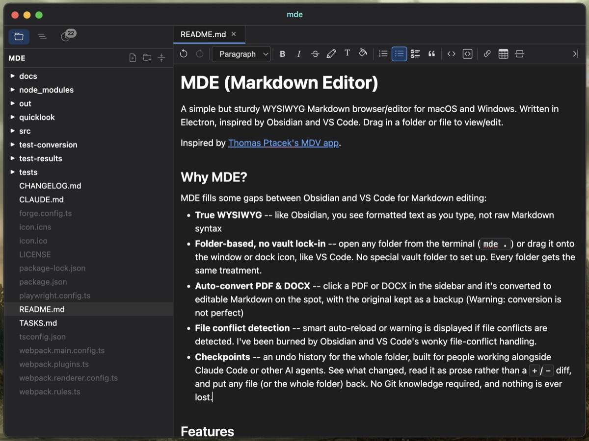

# MDE (Markdown Editor)



A simple but sturdy WYSIWYG Markdown browser/editor for macOS and Windows. Written in Electron, inspired by Obsidian and VS Code. Drag in a folder or file to view/edit.

Inspired by [Thomas Ptacek's MDV app](https://sockpuppet.org/blog/2026/05/12/emacsification/).

> ❗ Status: **Beta.** Stable and usable, but expect rough edges. Bug reports and feature requests welcome.

## Why MDE?

MDE fills some gaps between Obsidian and VS Code for Markdown editing:

- **True WYSIWYG** -- like Obsidian, you see formatted text as you type, not raw Markdown syntax
- **Folder-based, no vault lock-in** -- open any folder from the terminal (`mde .`) or drag it onto the window or dock icon, like VS Code. No special vault folder to set up. Every folder gets the same treatment.
- **Auto-convert PDF & DOCX** -- click a PDF or DOCX in the sidebar and it's converted to editable Markdown on the spot, with the original kept as a backup (Warning: conversion is not perfect)
- **File conflict detection** -- smart auto-reload or warning is displayed if file conflicts are detected. I've been burned by Obsidian and VS Code's wonky file-conflict handling.
- **Checkpoints** -- an undo history for the whole folder, built for people working alongside Claude Code or other AI agents. See what changed, read it as prose rather than a `+`/`-` diff, and put any file (or the whole folder) back. No Git knowledge required, and nothing is ever lost.

## Features

- **WYSIWYG editing** -- formatting toolbar with headings, bold, italic, strikethrough, highlight and text color (a ten-color palette that adapts to light/dark mode), lists, todo lists, blockquotes, code, links, tables, and horizontal rules..
- **Structured lists** -- Obsidian and VS Code both make it easy to produce invalid bullet/number/task lists. MDE gives you opinionated constraints.
- **File Explorer & Document Outline sidebar** -- keyboard-navigable, resizable, with context menu (rename, delete, copy path)
- **Tabbed editing** -- open multiple files, reorder by drag, tentative (preview) tabs on single-click
- **Find and replace** -- match highlighting, case-sensitive and whole-word filters, inline replace-all confirmation
- **Quick Open** -- Cmd+O fuzzy file search across the project
- **Standard editing tools** -- links, code blocks, tables
- **DOCX and PDF import** -- converts to Markdown on click, preserving structure (tables, headings, columns) where possible (not perfect!)
- **PDF and DOCX export** -- File > Export, or right-click a document (in the sidebar or its tab), to write a PDF or Word file beside it, with real headings, lists, tables, colors and working links to headings
- **File conflict detection** -- detects external changes; silent reload or warning banner
- **Checkpoints** -- opt-in version history for a folder. Snapshots save themselves automatically once things go quiet (or on demand, with a note). Clicking a changed file shows a word-level diff in plain prose -- added words green, removed words red -- and **Restore** asks which version you actually want: the way the file was *before* that change, or the way it came out *after* it. **Browse all checkpoints** opens the full history in a tab, where you can work back through every checkpoint, see how much each file changed, and rename a checkpoint to something you will recognise later. To follow a single document, right-click it in the file list (or right-click its tab) and choose **View Change History** -- the same tab, filtered to just the checkpoints that touched that file, which still works after the file has been deleted. Restoring never overwrites your history; it adds to it, so you can always go forward again. Folders that already have version history set up by other tools stay read-only unless you say otherwise.
- **Finder Quick Look** -- press spacebar on a `.md` file in Finder to see it rendered, not as raw Markdown, and Finder's file icons show the document's opening lines large enough to read (macOS; launch MDE once so macOS picks it up)
- **Dark mode** -- light, dark, or follow system preference
- **Terminal launcher** -- `mde .` to open a folder from the command line

## How to install

Download the latest build for your platform from the [releases page](https://github.com/topherhunt/mde/releases).

### macOS (Apple Silicon)

**No Terminal command needed.** MDE isn't notarized by Apple (that requires a paid Apple Developer account), so macOS blocks it on first launch. Clearing that is three clicks:

1. Open the `.dmg` and drag `MDE.app` to your **Applications** folder.
2. Double-click **MDE**. macOS says it "could not verify" the app is free of malware. Click **Done** (*not* "Move to Trash").
3. Open **System Settings > Privacy & Security**, scroll down to the **Security** section, and click **Open Anyway** next to the message about MDE. Confirm with Touch ID or your password, then click **Open Anyway** once more.

That's it -- MDE opens normally from then on, and you never have to repeat it.

> **Older instructions said to run** `xattr -d com.apple.quarantine`**. You don't need that anymore.** Builds before v0.5.0 shipped with a corrupted code signature, which made macOS report *tampering* ("MDE is damaged and can't be opened") instead of the ordinary unverified-developer warning -- and the damaged error has no Open Anyway button, leaving Terminal as the only way through. That's fixed as of v0.5.0. If you're stuck on an older build, just download the current release rather than running the command.

Right-click > Open also no longer works on macOS Sequoia (15) or later; Apple removed that shortcut. System Settings is the way.

### Windows

Run `MDE-<version> Setup.exe`. Because the app isn't code-signed, Windows SmartScreen ("Windows protected your PC") will appear the first time you run the installer **and** the first time you launch the app:

1. Click **More info**
2. Click **Run anyway**

You only need to do this once per machine. (Your browser may also warn that the download is "not commonly downloaded" -- choose **Keep** / **Keep anyway**.)

Once installed, double-clicking a `.md` file or choosing MDE from **Open with** will open it in MDE.

## Note on images

Images in a file are shown inline: relative paths resolve against the file's own folder, and `https://` images load from the web. If an image can't be found, MDE shows a placeholder naming the path it looked for. Either way the image reference is saved back exactly as you wrote it. Click an image to see its path; right-click it to reveal the file in Finder or remove it from the document. Pasting a screenshot, or web content that contains images, asks where the images should go: saved into a folder next to the document (`images/` unless you type another name; an existing file is never overwritten), kept as links to the web, or removed. Dropping an image file onto the document, or picking one with the toolbar's image button, asks the same way and copies it in. MDE never embeds image data in the Markdown itself.

## Note on HTML in Markdown

Handling `<` and `>` characters in Markdown is a surprisingly subtle problem. MDE does not render raw HTML -- tags like `<ol>` or `<div>` are displayed as literal text, not interpreted as HTML elements. As a side effect, if your `.md` files contain HTML entities like `&gt;` or `&lt;`, MDE may convert them to their literal characters (`>`, `<`) on save. This improves readability but means MDE-edited files may differ slightly from files authored in raw-text editors that preserve HTML entities verbatim.

## Getting started

```
npm install
npm start
```

Drag a folder onto the window to open it as a project, or use File > Open.

### Terminal launcher

Open Settings (Cmd+,) and click "Install terminal launcher" to enable opening folders from the terminal:

```
mde .              # Open current directory
mde ~/my-notes     # Open a specific folder
```

On Windows the launcher adds itself to your user `PATH`, so open a **new** terminal window after installing it before running `mde`.

## Tests

```
npm test
```

Runs headless Playwright E2E tests against a packaged build.

## Dev & test caveats

- In dev and test, dragging files/folders onto the dock app icon doesn't work. You need to manually test on the packaged app.
- In test, dragging files/folders into the app window doesn't work AFAICT. The tests skip this step and simulate triggering the drop, meaning potential bug space.

## Build & distribute

```
npm run release
```

Produces distributables in the `out/make/` directory. Note that Electron Forge only builds for the OS you run it on: macOS produces a `.dmg`, Windows produces a Squirrel `Setup.exe`. You **cannot** reliably cross-build the Windows installer from macOS (it needs Windows-native tooling), so releases are built in CI instead.

### Cutting a release (GitHub Actions)

Releases are built and published by `.github/workflows/release.yml`, triggered by pushing a version tag:

```
# bump "version" in package.json first (so the installer filename matches), then:
git tag v0.2.0
git push origin v0.2.0
```

This runs two parallel build jobs (`macos-latest` -> `.dmg`, `windows-latest` -> `Setup.exe`) and attaches both to a GitHub Release for that tag. The Release is created as a **draft** -- review it, smoke-test the Windows installer (file associations only register during a real install), then click **Publish**. To auto-publish instead, remove `draft: true` from the workflow.

Notes:

- The workflow file must exist on the commit the tag points to, so push your changes to `main` before tagging.
- The macOS build is Apple Silicon (arm64) only -- `macos-latest` runners are arm64. Intel Macs aren't covered.
- You can also trigger the workflow manually (Actions tab -> "Build and Release" -> Run workflow) to verify the builds compile without creating a release.

### Running the test suite on Windows

`.github/workflows/windows-tests.yml` runs the full Playwright E2E suite on `windows-latest` to catch Windows-specific breakage (path handling, launch behavior). It's manually triggered: Actions tab -> **Windows Tests** -> **Run workflow**.

On failure it uploads Playwright traces as a build artifact; download and inspect with `npx playwright show-trace <trace.zip>`.

(`workflow_dispatch` workflows only appear in the Actions tab once the file is on the default branch, so push to `main` first.)

## Tasks

### For me

- Customizable export styling (fonts, colors, page size) for PDF / DOCX export
- **Add Claude agent support.**
- Support viewing & simple editing of .csv files too.

### For Claude
